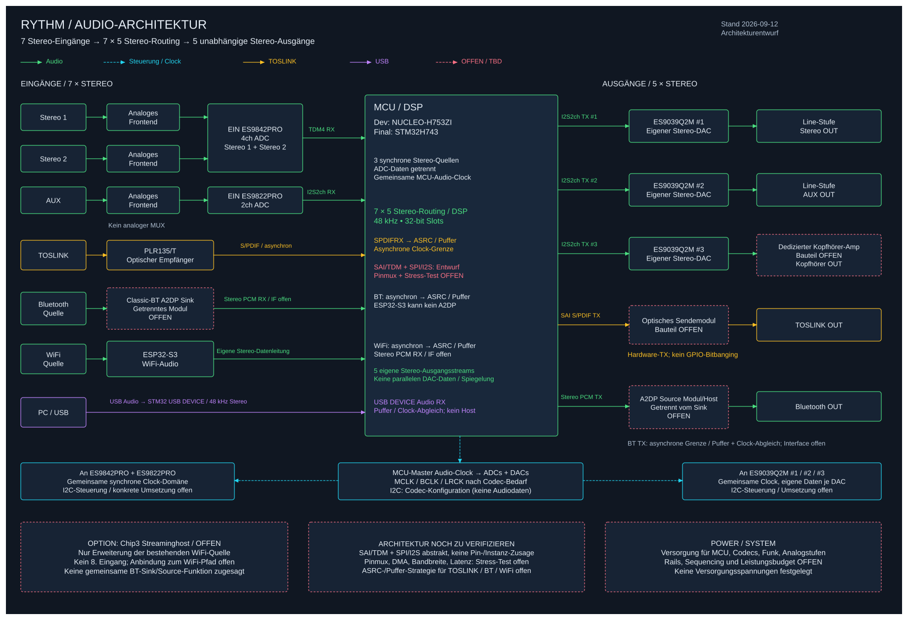

# RHYTHM – Custom Audio Interface

> Stand: 2026-09-12 · Architekturentwurf, kein Nachweis einer bereits implementierten Audio-Pipeline.

RHYTHM ist ein selbstgebautes Audio-Interface / digitaler Vorverstärker mit **7 Stereo-Eingängen und 5 Stereo-Ausgängen**, 7-Band-Parametrik-EQ, großem Volume-Regler und beleuchteten Output-Tasten.

## Projektziele

- Alle sieben Quellen gleichzeitig erfassbar, digital über eine **7×5-Stereo-Routingmatrix** auf fünf unabhängig bedienbare Ziele verteilen.
- Lokale Verarbeitung mit 48 kHz, Float32-DSP und 32-Bit-Audio-Slots. Wortbreite ist nicht gleich effektive Wandlerauflösung.
- Analoge Quellen ohne Eingangsmultiplexer: **1× ES9842PRO für Stereo 1 und Stereo 2**, **1× ES9822PRO für AUX**.
- Haptische Bedienung: sieben Quellwahltasten, sieben EQ-Drehknöpfe, ein Volume-Regler, fünf beleuchtete Output-Tasten.

## Eingänge (7 Stereoquellen / 14 Audiokanäle)

1. Stereo 1 – analog, ES9842PRO Kanäle 1/2.
2. Stereo 2 – analog, ES9842PRO Kanäle 3/4.
3. AUX – analog, ES9822PRO Kanäle 1/2.
4. TOSLINK – optischer S/PDIF-Eingang, Empfänger → STM32-SPDIFRX → Taktratenanpassung.
5. Bluetooth – A2DP-Sink; Classic-Bluetooth-fähiges Modul/Host noch auszuwählen.
6. WiFi – Netzwerkstream, ESP32-S3; eigener Audiostream, nicht mit BT vorab umgeschaltet.
7. **USB – neu: Stereo-Audio vom PC an RHYTHM als USB-Audio-Device.** Kein USB-Host, kein USB-Stick-Player; Class-Version/Deskriptoren noch festzulegen.

## Ausgänge (5 Stereoziele / 10 Audiokanäle)

1. Stereo – ES9039Q2M #1 → Line-Ausgangsstufe.
2. AUX – ES9039Q2M #2 → Line-Ausgangsstufe.
3. Kopfhörer – eigener DAC-Pfad (ES9039Q2M #3 als Planungsansatz) → geeigneter Kopfhörerverstärker.
4. TOSLINK – STM32-SAI im S/PDIF-TX-Modus → optisches Sendemodul.
5. Bluetooth – A2DP-Source → BT-Lautsprecher/Kopfhörer; separates Modul/Host noch offen.

Ein vom Stereo-DAC abgezweigter Kopfhörerverstärker erlaubt keinen unabhängigen Kopfhörermix und erfüllt deshalb nicht die vollständige 7×5-Zielarchitektur.

## Plattform und Machbarkeit

- Entwicklung: vorhandenes **NUCLEO-H753ZI / STM32H753ZI**, CPU-Ziel 400 MHz.
- Ziel-MCU weiterhin **STM32H743**; genaue Bestellnummer, Package und Board-Pinmux noch freizugeben.
- Audio: SAI/TDM plus SPI/I²S, DMA, SPDIFRX und USB-Device statt der alten vereinfachten Drei-I²S-Bus-Planung.
- **ESP32-S3 hat kein Bluetooth Classic und kann weder A2DP-Sink noch A2DP-Source übernehmen.** Er bleibt WiFi-Kandidat; die BT-Hardware ist offen.
- Optionaler Streaming-Host (z. B. Raspberry Pi Zero 2 W) bleibt offen und erweitert die WiFi-Quelle, nicht die Zahl der Eingänge.
- Plattform grundsätzlich plausibel, aber noch nicht als komplettes 7×5-System nachgewiesen: Pinmux, DMA, Clock-Domänen, USB, Funkmodule und Echtzeitlast müssen getestet werden.
- Bei der Prüfung wurde außerdem ein widersprüchlicher aktueller PLL1-Entwurf gefunden; Details im [Controller-Check](docs/hardware/controller-capacity.md). Firmware und Boardzustand wurden bei dieser Dokumentationsänderung nicht verändert.

## Dokumentation

- [Anforderungen](docs/requirements.md)
- [Systemarchitektur](docs/architecture.md)
- [Plattform, Wandler und BOM-Status](docs/hardware/platform.md)
- [Signalpfad und Clocking](docs/hardware/signal-path.md)
- [Controller-Kapazität und Freigabekriterien](docs/hardware/controller-capacity.md)
- [Firmware / Build](firmware/README.md)



[Editierbare Excalidraw-Quelle](docs/hardware/block-diagram.excalidraw)

## Entwicklungsstand / nächste Schritte

- [x] ADC-Auswahl: ES9842PRO + ES9822PRO; kein analoger Quell-MUX.
- [x] USB als siebten Stereo-Eingang aufgenommen.
- [x] DAC-Familie: ES9039Q2M; dritter DAC-Pfad für unabhängige Kopfhörerausgabe eingeplant.
- [x] Toolchain: PlatformIO + VS Code, STM32Cube-HAL; FreeRTOS optional.
- [ ] CPU-Clock-Konfiguration korrigieren und am Board nachweisen (separate Firmwareänderung).
- [ ] Vollständige SAI/I²S/USB/SPDIFRX-Pinmap und DMA-Zuordnung für H753ZI und finales H743-Package.
- [ ] BT-Sink- und BT-Source-Hardware sowie Codec-/Clocking-Verhalten auswählen.
- [ ] ADC-/DAC-Frontend, Versorgung, Kopfhörerverstärker, USB-Anschluss und Schutzbeschaltung dimensionieren.
- [ ] USB-Audio, Taktratenanpassung, 7×5-Mixer und 7-Band-EQ implementieren und gemeinsam testen.
- [ ] BOM mit aktuellen Händlerpreisen erstellen; alte Gesamtsummen gelten nicht mehr.
- [ ] Gehäuse, Frontpanel und Lizenz festlegen.

## Budget

Ziel weiterhin 150–200 € ideal, 500 € Obergrenze. Für zwei PRO-ADCs, drei unabhängige analoge Ausgangspfade, USB und separate BT-Funktionen liegt noch keine belastbare Gesamt-BOM vor. Siehe [Plattform](docs/hardware/platform.md); keine Budgeteinhaltung zugesichert.

## Repo-Struktur

```text
rhythm/
├── README.md
├── docs/              # Anforderungen, Architektur, Hardware
├── firmware/          # H753-Entwicklung, Build, Tests
├── pcb/               # KiCad-Entwürfe; noch kein 7×5-Freigabenachweis
└── mechanical/
```

## Lizenz

Offen – TBD. Bestehende Drittanbieter-Lizenzen unter `firmware/vendor_h753/` bleiben gültig und unverändert.
