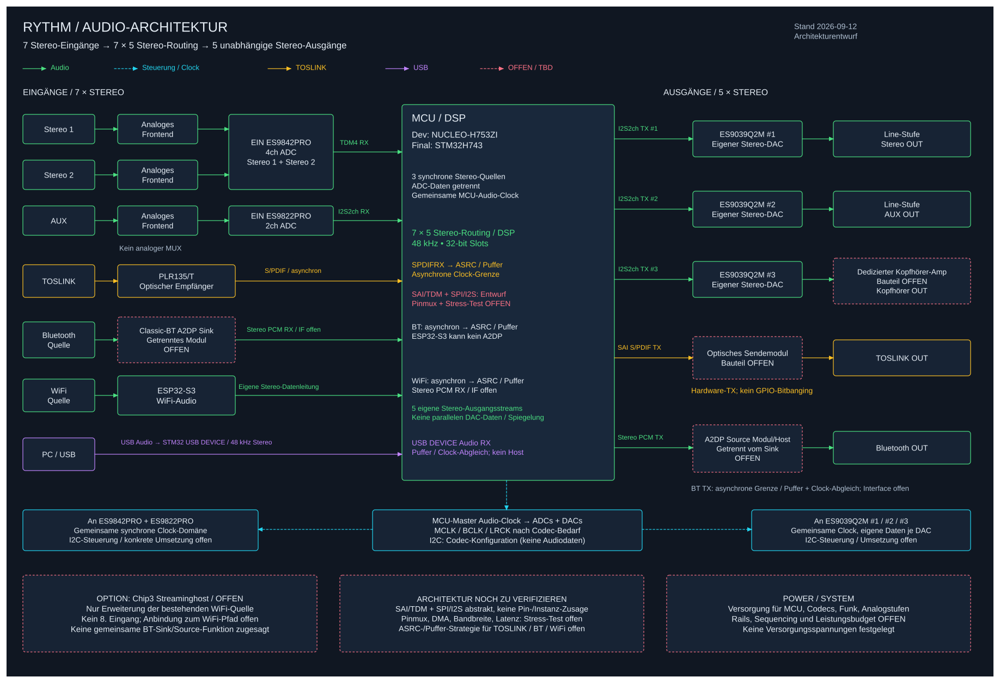

# RHYTHM – Systemarchitektur

> Stand: 2026-09-13 · Zielarchitektur für **7 Stereo-Eingänge und 5 unabhängig routbare Stereo-Ausgänge**.
> Dokumentierter Entwurf, keine vollständige Hardware-/Firmwarefreigabe. Die alte „3× I²S genügt“-Topologie wird ersetzt.

## 1. Entscheidungen und Systemrollen

| Baugruppe | Rolle | Status |
|-----------|-------|--------|
| STM32H743 | Lokaler Audio-DSP, 7×5-Routing, EQ, UI, USB-Audio-Device | Ziel-MCU unverändert; konkrete Pinbelegung offen |
| NUCLEO-H753ZI / STM32H753ZI | Aktuelle Entwicklung | 400 MHz CPU-Ziel; Clock-Befund beachten |
| ES9842PRO, 1 Stück | Stereo 1 und Stereo 2 gemeinsam digitalisieren | Nutzerentscheidung: vier getrennte Wandlungskanäle |
| ES9822PRO, 1 Stück | AUX digitalisieren | Nutzerentscheidung: zwei Wandlungskanäle |
| ESP32-S3 | WiFi-/Netzwerkstream dekodieren, Stereo-PCM liefern | Kein A2DP: S3 unterstützt kein Bluetooth Classic |
| Classic-BT-Sink | BT-Eingang, AVRCP nach Stack-/Modulauswahl | Hardware/Host noch offen, eigener Audiopfad |
| Classic-BT-Source | BT-Ausgang | Hardware/Host noch offen, unabhängig vom Eingang |
| Optionaler Streaming-Host | AirPlay/Spotify/UPnP innerhalb der WiFi-Quelle | Bewusst offen, RPi Zero 2 W nur Option |

Keine feste „3-Chip-Garantie“: Für gleichzeitiges BT RX/TX kann zusätzliche Funkhardware nötig sein. Ein Host darf mehrere Rollen nur übernehmen, wenn unabhängige Audioströme, Profile und Busse nachgewiesen sind.

## 2. Hardware-Blockschaltbild



[Editierbare Excalidraw-Quelle](hardware/block-diagram.excalidraw) · [Signalpfad/Clocking](hardware/signal-path.md)

```text
Stereo 1 L/R -- Frontend -- ES9842PRO CH1/2 --+
Stereo 2 L/R -- Frontend -- ES9842PRO CH3/4 --+-- TDM4 ----+
AUX L/R ------ Frontend -- ES9822PRO CH1/2 ------ I2S -----+
TOSLINK ------ Empfaenger -- SPDIFRX -- ASRC/Puffer -------+
BT ----------- Classic-BT Sink (offen) -- PCM/Rate-Matching +
WiFi --------- ESP32-S3 -- PCM/Rate-Matching --------------+--> STM32
PC USB ------- USB Audio DEVICE -- Feedback/Puffer -------+    48 kHz
                                                              Float32
                                                              7x5 Stereo
                                                              EQ/Gain/Mute
                                                                  |
       +---------------------+---------------------+---------------+---+
       |                     |                     |               |   |
 ES9039Q2M #1          ES9039Q2M #2          ES9039Q2M #3      SAI SPDIF  BT Source
 Line-Stufe            Line-Stufe            KH-Verstaerker   TX-Modul  (offen)
 Stereo Out            AUX Out               Kopfhoerer       TOSLINK  BT Out
```

**Kein analoger Eingangsmultiplexer:** Beide Stereo-Eingänge und AUX werden gleichzeitig erfasst. Die Quellwahl geschieht ausschließlich digital im Mixer.

## 3. Lokale Audio-Pipeline

- Sieben Stereo-Quellen = 14 Eingangskanäle; fünf Stereo-Ziele = 10 Ausgangskanäle.
- Lokale Sample-Rate 48 kHz, Float32-DSP, 32-Bit-Slots auf den seriellen PCM-Verbindungen.
- 7×5-Stereo-Routingmatrix (L/R gepaart), individuelle Gain-/Mute-Werte, definierter Summen-Headroom.
- 7-Band-Parametrik-EQ; Zuordnung der Bedienregler zu globaler/Quell-/Ziel-Ebene noch festlegen.
- Blockverarbeitung mit DMA-Ping-Pong, als Rechenbeispiel 48 Frames pro Block. Keine Speicherallokation oder Netzwerk-/USB-Warteschleifen im Echtzeitpfad.
- Netzwerk-/BT-Dekodierung im Frontend/Host; STM32 erhält PCM, nicht unbudgetierte Codec-Dekodierung zusätzlich zum DSP.
- DSP-Puffer aus DMA-erreichbarem RAM, Cache-Policy und Speicherbarrieren explizit behandeln; SAI4/BDMA hat andere Speichergrenzen als DMA1/2.

## 4. Analoge Eingänge

| Quelle | ADC | Kanalzuordnung | Digitaler Transport |
|--------|-----|---------------|---------------------|
| Stereo 1 | ES9842PRO | CH1=L, CH2=R | TDM4 RX, Slots 0/1 |
| Stereo 2 | Derselbe ES9842PRO | CH3=L, CH4=R | Derselbe TDM4 RX, Slots 2/3 |
| AUX | ES9822PRO | CH1=L, CH2=R | Separate Stereo-I²S-RX-Leitung |

Beide ADCs als Audio-Slaves; MCLK/BCLK/Frame-Clock aus der lokalen Audio-Taktquelle. I²C oder SPI für Register-Konfiguration, eigene konfliktfreie Adressen bzw. Chip-Selects. Eingangstreiber, Pegel, Common-Mode, Referenzen und Versorgung nach den konkreten ADC-Datenblättern auslegen.

Die TDM-Daisy-Chain-Fähigkeit der ADCs bietet eine spätere Busoptimierung, ist aber nicht als bereits getestete gemeinsame Datenleitung eingeplant.

## 5. Digitale Eingänge und Clock-Domänen

### TOSLINK

Optischer Empfänger (bisher PLR135/T) → **STM32-SPDIFRX** → DMA → Entpackung/Statusprüfung → ASRC oder äquivalente adaptive Taktratenanpassung → 48-kHz-DSP-Puffer.

SPDIFRX ist eine echte MCU-Peripherie, kein GPIO-Softwaredecoder. Es führt nicht automatisch eine ASRC aus. Auch ein externer 48-kHz-Sender driftet gegenüber der lokalen Clock. Andere Eingangs-Sampleraten werden erst nach Festlegung und Test des SRC-Bereichs freigegeben.

### Bluetooth

- Eingang: Handy/PC → **A2DP-Sink** → PCM zum STM32.
- Ausgang: PCM vom STM32 → **A2DP-Source** → BT-Lautsprecher/Kopfhörer.
- Getrennte logische und physische Audiopfade reservieren. Gleichzeitiger Betrieb und konkrete Codecs/Profile erst nach Modulauswahl garantieren.
- ESP32-S3 ist dafür ungeeignet: BLE ersetzt Bluetooth Classic/A2DP nicht.
- Ein als Slave getakteter I²S-Port löst nicht automatisch den Drift der Funkquelle; Frontend braucht elastische Puffer und Rate-Matching. BT-Latenz separat behandeln.

### WiFi

ESP32-S3 dekodiert Netzwerkstream und liefert einen **eigenständigen** Stereo-PCM-Strom. BT und WiFi dürfen nicht vor dem STM32 auf eine einzige Stereo-Datenleitung umgeschaltet oder gemischt werden, wenn sie unabhängig in der 7×5-Matrix verfügbar bleiben sollen.

Optionaler Streaming-Host ersetzt/erweitert diese Netzwerkfunktion, ist kein achter Eingang. UART/SPI für Status/Steuerung gesondert von Audio planen; benötigte Streamingformate und Resamplerleistung noch testen.

### USB – neuer siebter Eingang

**PC als USB-Host → STM32 als USB-Audio-Device → lokaler Stereo-DSP-Eingang.** Initial 48 kHz. USB-OUT bedeutet aus Hostsicht „zum Gerät“ und ist hier Audio-Eingang.

- Dedizierter MCU-USB-Port; ST-Link-Debug-USB ist kein frei nutzbarer Audioanschluss der Ziel-MCU.
- Ein Stereo-Playback-Stream passt bei 48 kHz in USB Full Speed. UAC-Version, Wortbreiten, Hostkompatibilität und Deskriptoren sind noch festzulegen.
- Asynchrones Playback mit explizitem Feedback als Planungsansatz; Feedback aus tatsächlichem Audioverbrauch ableiten und Hostverhalten testen.
- Korrekte USB-48-MHz-Taktquelle, D+/D−, VBUS-Erkennung und ESD-Schutz vorsehen.
- Kein USB-Host, USB-Stick-Player oder USB-Aufnahmeausgang vereinbart.

## 6. Unabhängige Ausgänge

- Stereo: ES9039Q2M #1 mit eigenem Stereo-PCM → Line-Ausgang.
- AUX: ES9039Q2M #2 mit eigenem Stereo-PCM → Line-Ausgang.
- Kopfhörer: eigener DAC-Pfad, **ES9039Q2M #3 eingeplant**, danach dedizierter Kopfhörerverstärker; Leistung/Impedanz/Schutz offen.
- TOSLINK: **SAI im S/PDIF-TX-Modus**, DMA, optisches Sendemodul passend zum elektrischen Ausgang; keine selbstgebaute IR-LED als ungeprüfter TOSLINK-Ersatz.
- BT: eigener Stereo-PCM-Ausgang an Classic-BT-A2DP-Source-Modul/Host (offen).

Getrennte DAC-Datenleitungen erlauben getrennte Mixe; gemeinsame Takte sind zulässig. Zwei DACs und ein analog abgezweigter Kopfhörerausgang wären nur eine reduzierte Demonstration, nicht die vollständige Zielarchitektur.

## 7. Controller und Schnittstellenbudget

Die alte Pauschalannahme „drei I²S-Ports reichen“ war nicht ausreichend: Vierkanal-ADC, getrennte BT/WiFi-Eingänge, unabhängige Ausgangsmixe und asynchrone Quellen verlangen einen konkreten SAI/TDM-/SPI-I²S-Plan.

**Prüfergebnis und Ressourcenbelegung:** [controller-capacity.md](hardware/controller-capacity.md).

Bewertung: H753/H743 sind grundsätzlich plausible Kandidaten für 48-kHz-7×5-Audio; endgültige Freigabe erfordert Package-Pinmux, DMA-/RAM-Zuordnung, Clocking, ausgewählte Funkmodule und einen realen Worst-Case-Test. Keine erfundenen CPU-Prozentwerte und kein Boot-/Build-Erfolg als Audio-Nachweis.

Zusätzlicher aktueller Blocker: Der vorgefundene `firmware/src/board_clock.c`-Entwurf enthält PLL1 M=4, N=100, P=2 bei HSI=64 MHz; das ergibt rechnerisch 800 MHz, nicht 400 MHz. Die Firmware bleibt bei dieser Dokuänderung unangetastet. Details und Abgrenzung im Kapazitätsbericht.

## 8. Bedienung / Firmware-Schichten

**Initialer Softwareentwurf:** [Softwarearchitektur v0.1](firmware/software-architecture.md) mit Modulverantwortlichkeiten, Audio-/Control-Trennung, Clock-Anpassung, DMA-/Buffer-Ownership, Fehlerbehandlung und Teststrategie. Drei editierbare Excalidraw-Grafiken samt SVG-Ansichten erläutern Schichten, Audiodatenfluss und Laufzeit. Softwarevorschläge (insbesondere EQ je Ausgang und UI-Zuordnung) sind dort ausdrücklich als noch zu bestätigende Entscheidungen gekennzeichnet; keine Firmwareimplementierung durch diese Dokumentation.

- Acht Encoder (7 EQ + Volume), sieben Quelltasten, fünf Output-Tasten plus LEDs.
- GPIO-Scanning/Entprellung statt einer unvalidierten Zuordnung jedes Encoders zu einem eigenen Timer; TIM6/7 sind keine Quadratur-Encoder-Timer.
- Schichten: Clock/BSP → SAI/I²S/SPDIFRX/USB/DMA → PCM-Puffer/SRC → Mixer/EQ/Gain → UI/Control.
- I²C/SPI für ADC/DAC-Initialisierung, UART/SPI für Frontend-Status; RTOS optional, DSP bleibt deterministisch.
- Vorhandene Firmware ist Boot-/Clock-Entwicklung. SAI-, SPDIFRX-, USB-Audio- und vollständige DSP-Treiber sind noch zu ergänzen; keine implizite Umsetzung durch diese Dokuänderung.

## 9. Freigabekriterien / nächste Schritte

1. CPU-/Bus-Clock-Konfiguration korrigieren und am vorhandenen Board prüfen; separate Firmwarefreigabe.
2. Pinmux auf tatsächlichem H753ZI-Board und finalem H743-Package inklusive Debug, USB, SAI/I²S, UI und DMA festlegen.
3. ADC-/DAC-MCLK und Slot-/Frame-Konfiguration aus Datenblättern ableiten; USB- und Audio-Clocks nicht verwechseln.
4. BT-Sink/Source-Lösung wählen, WiFi-PCM und unabhängige gleichzeitige Streams testen.
5. USB-Feedback und TOSLINK-/BT-/WiFi-Rate-Matching implementieren; keine bloßen Sample-Drops als Qualitätslösung.
6. Alle sieben Stereoquellen mit identifizierbaren Signalen erfassen und alle fünf Ziele unabhängig prüfen; EQ-Volllast, Pufferdrift, Latenz und Aussetzer messen.
7. Frontends, Versorgung, Kopfhörerverstärker, Gehäuse und BOM ausarbeiten; KiCad-Schaltpläne/Layouts danach separat abgleichen.

## Quellen

- ADC-Datenblätter und Status: [platform.md](hardware/platform.md).
- STM32-/Espressif-Quellen und Rechenmodell: [Controller-Kapazität](hardware/controller-capacity.md).
