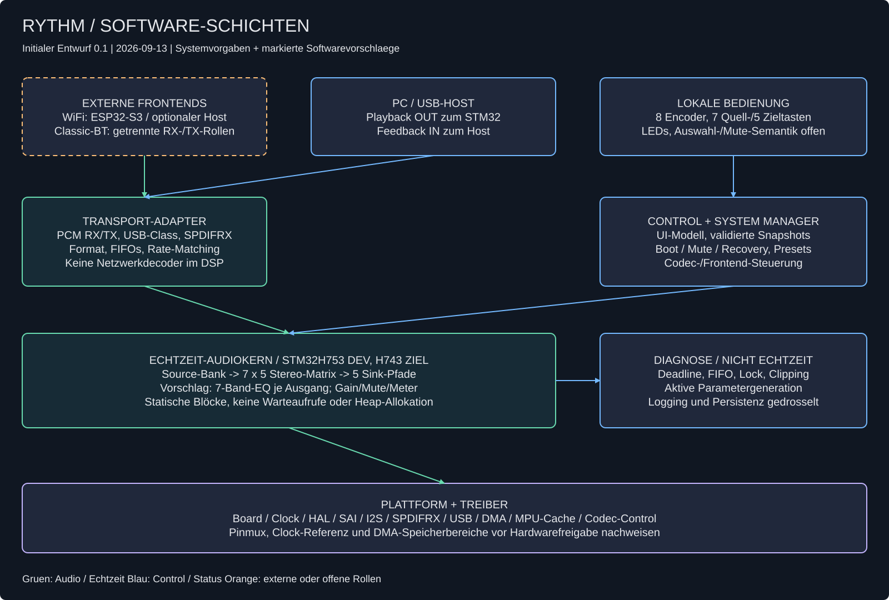
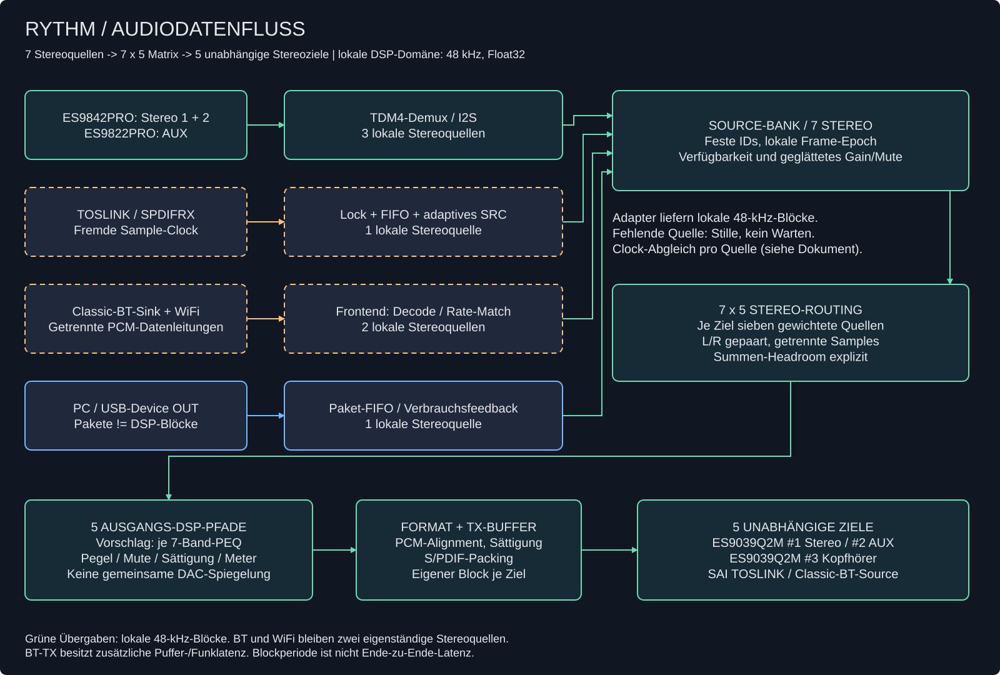
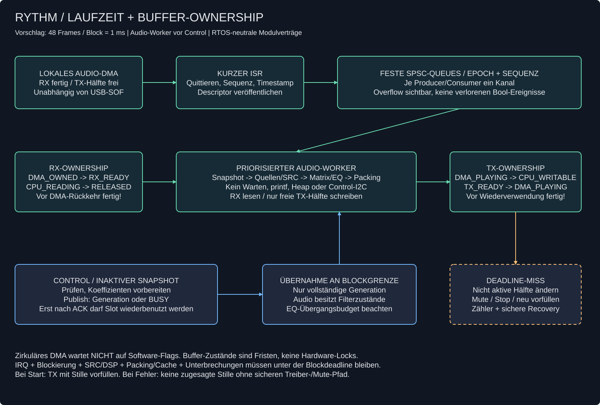

# Rythm – Initiale Softwarearchitektur

> Stand: 2026-09-13 · Version 0.1 · **Entwurf zur fachlichen Prüfung, keine Implementierungs- oder Hardwarefreigabe.**
> Geltungsbereich: STM32H753ZI im Prototyp, STM32H743 als Ziel-MCU; Softwareverträge zu WiFi und Classic-Bluetooth.

## 1. Grundlage, Status und Abgrenzung

Die Architektur leitet sich aus [Systemarchitektur](../architecture.md), [Anforderungen](../requirements.md), [HW-Blockschaltbild](../hardware/block-diagram.excalidraw), [Signalpfad/Clocking](../hardware/signal-path.md) und [Controller-Kapazitätsprüfung](../hardware/controller-capacity.md) ab. Bei Hardwarefragen bleiben diese Dokumente maßgeblich. Die dortigen Pin-/SAI-Belegungen sind Kandidaten, keine verbindlichen Treiberinstanzen.

**Festgelegt durch die Systemunterlagen:** sieben gleichzeitig verfügbare Stereoquellen, fünf unabhängige Stereoausgänge, 7×5-Routing mit gepaartem L/R, lokale 48 kHz, Float32-DSP, sieben parametrische EQ-Bänder und separate Clock-Anpassung asynchroner Quellen. Kein analoger Eingangsmultiplexer. Drei unabhängige DAC-Datenströme.

**Vorschläge dieses Dokuments:** ausgangsbezogener EQ, statischer blockbasierter Audiokern, RTOS-neutrale Schnittstellen, Double-Buffer-Konfigurationsübergabe, Zustands-/Fehlerkonzept. Diese Vorschläge sind keine bereits beschlossenen Produktanforderungen.

Nicht enthalten: Firmwareänderungen, Flashen, konkrete Codec-Registertabellen, finaler Pinmux, neue Bauteilauswahl, USB-Host/Recording, Netzwerkdecoder auf dem STM32, Zusage synchroner Bluetooth-/Line-Ausgabe. Die Implementierungsstufen unten sind eine technische Reihenfolge, kein gestarteter Mehrtages-Umsetzungsplan.

## 2. Software-Komponenten und Verteilung

[Editierbare Excalidraw-Quelle](software-layers.excalidraw)

### 2.1 Verteilung auf Prozessoren

| Recheneinheit | Verantwortung | Grenze zum STM32 |
|---|---|---|
| STM32H753/H743 | Lokale Audio-Clock, PCM-Erfassung/Ausgabe, SRC für TOSLINK, Routing, EQ, Pegel, UI, USB-Device, Diagnose | Echtzeit-Audiokern ohne Netzwerk-/Codec-Decoding |
| ESP32-S3 / optionaler Netzwerkhost | WiFi-Protokoll, Decoder, Jitterpuffer, SRC/Verbrauchsanpassung | Eigener Stereo-PCM-Stream plus separater Status-/Steuerkanal |
| Classic-BT-Sink, Hardware offen | A2DP-Empfang, Decoder, Puffer, Rate-Matching; AVRCP nach Auswahl | Eigener Stereo-RX-Stream, unabhängig von WiFi |
| Classic-BT-Source, Hardware offen | PCM-Annahme, Puffer, Encoder und Funkübertragung | Eigener Stereo-TX-Stream; kein Backpressure in den lokalen Audiokern |
| PC | USB-Host und Playback-Quelle | Isochroner Audio-OUT zum Gerät; Feedback-IN zurück zum Host |

Ein gemeinsamer Host für mehrere Rollen ist nur zulässig, wenn getrennte Audiopfade und gleichzeitiger Betrieb nachgewiesen sind. Der ESP32-S3 erhält keine A2DP-Aufgabe.

### 2.2 Module und Abhängigkeitsregeln

| Modul / vorgeschlagener Ort unter `firmware/src/` | Verantwortung | Darf nicht |
|---|---|---|
| `app/system_manager` | Boot-/Run-/Fehlerzustände, Start-/Stop-Sequenzen, Recovery | Direkt Audio-DMA-Puffer beschreiben |
| `control/control_model` | Routing, EQ-/Volume-Ziel, Parameterprüfung, Konfigurationsgeneration | Aktive DSP-Zustände parallel ändern |
| `control/ui_scan`, `ui_presenter` | Entprellte Encoder-/Tastenereignisse, LED-Abbild | I²C/Flash oder Audio im GPIO-ISR ausführen |
| `control/preset_store` | Versionierte Presets, CRC, Migration, atomare Speicherung | Ungeprüfte Presets aktivieren oder Flash-Erase im Audioblock |
| `audio/audio_engine` | Einziger Eigentümer der DSP-Zustände; blockweises Scheduling | Warten, Heap-Allokation, printf, Dateisystem-/Bus-Control-Zugriff |
| `audio/source_bank`, `sink_bank` | Stabile Source-/Sink-IDs, Gültigkeit, Blocksequenzen | Physische SAI-Instanz als logische Quellen-ID benutzen |
| `audio/pcm_format`, `rate_match` | TDM-Demux, Alignment, Integer/Float, SRC und elastische FIFOs | FIFO allein als dauerhafte Driftlösung behandeln |
| `dsp/matrix`, `peq`, `gain`, `meter` | Plattformunabhängige C-Verarbeitung; CMSIS-DSP als austauschbares Backend | HAL-/RTOS-/USB-Typen in öffentliche DSP-Header aufnehmen |
| `drivers/audio_transport` | SAI/I²S/SPDIFRX, DMA-Ownership und Transportfehler | Mixer-/UI-Policy entscheiden |
| `drivers/usb_playback` | USB-Class, Paketprüfung, PCM-FIFO, Feedback und Streamzustand | USB-SOF als lokale Audio-Clock verwenden |
| `drivers/codec_control`, `frontend_control` | ADC-/DAC-Register, Mute/Reset, versioniertes Frontend-Protokoll | Im Echtzeitpfad blockieren |
| `platform/board`, `clock`, `dma_memory` | Package-/Boardmapping, Takte, MPU/Cache, Linkersektionen, IRQ-Anbindung | H753-Boardannahmen im DSP verteilen |
| `diagnostics/health` | Zähler, High-Water-Marks, Timing, Watchdog-Entscheidung | Unbegrenztes Logging aus Interrupts |

Abhängigkeiten zeigen von Anwendung zu Audio-/Control-Diensten und über abstrakte Treiberschnittstellen zur Plattform. Interrupt-Callbacks liefern ausschließlich Ereignisse/Deskriptoren. DSP-Code bleibt host-testbar. Der vorhandene HAL/CMSIS-Vendorbaum wird nicht als Ablage für Anwendungslogik benutzt.

Die Ordner sind ein **Zielvorschlag**, hier nicht angelegt. Bestehende `bsp.*`, `board_clock.*` und `usb/*` werden später schrittweise adaptiert, nicht pauschal ersetzt.

## 3. Audiodatenmodell und Signalfluss

[Editierbare Excalidraw-Quelle](audio-dataflow.excalidraw)

### 3.1 Stabile IDs und Hardwareadapter

| Source-ID | Adapter | Ausgabe an Source-Bank |
|---|---|---|
| `SRC_STEREO1` | ES9842PRO TDM4 Slots 0/1 | Stereo Float32 |
| `SRC_STEREO2` | Derselbe TDM4-Block, Slots 2/3 | Stereo Float32; gleiche Sequenz wie Stereo 1 |
| `SRC_AUX` | ES9822PRO Stereo-I²S | Stereo Float32 |
| `SRC_TOSLINK` | SPDIFRX, Status/Lock, asynchrones SRC | Stereo Float32 in lokaler Clock-Domäne |
| `SRC_BT` | Separater Sink-PCM-Port | Stereo Float32; Frontend garantiert Rate-Matching oder Quelle bleibt nicht freigegeben |
| `SRC_WIFI` | Separater ESP32-/Host-PCM-Port | Wie BT, aber eigener Stream und Status |
| `SRC_USB` | USB-Audio-Device OUT, Paket-FIFO, Feedback | Entkoppelt von USB-Paketgrenzen, Stereo Float32 |

| Sink-ID | Adapter |
|---|---|
| `SINK_STEREO` | Eigener PCM-TX → ES9039Q2M #1 |
| `SINK_AUX` | Eigener PCM-TX → ES9039Q2M #2 |
| `SINK_HP` | Eigener PCM-TX → ES9039Q2M #3 → Kopfhörerverstärker |
| `SINK_TOSLINK` | PCM-/Channel-Status-Packing → SAI S/PDIF-TX |
| `SINK_BT` | Separater PCM-TX → Classic-BT-Source; eigener Fehler-/Pufferstatus |

### 3.2 Blockvertrag

Planungswert `AUDIO_BLOCK_FRAMES = 48` bei 48.000 Frames/s: **1 ms Blockperiode**. Ein Frame enthält die zeitgleichen Kanäle eines Streams; nicht mit USB-Frame oder einem einzelnen Sample verwechseln. Die endgültige Blockgröße hängt vom gemessenen Worst Case ab.

Intern: `float samples[channel][frame]`, also planare L/R-Blöcke pro Quelle und Ziel. Transportpuffer sind davon getrennt, üblicherweise interleavte Integer-Slots. Ein `AudioBlock`-Deskriptor trägt Source-/Sink-ID, Generation/Epoch, Blocksequenz, lokalen Frame-Zeitstempel, Framezahl und Flags (`VALID`, `DISCONTINUITY`, `SILENCE`, `LOCK_LOST`). Nach einem Neustart verhindert die Epoch die Verarbeitung veralteter Callbacks.

32-Bit-Slots bedeuten nicht automatisch 32 Bit gültige PCM-Auflösung. Jeder Adapter beschreibt Wortbreite, gültige Bits, Vorzeichen, Endianness, Slot-Alignment und Skalierung. Integer→Float normiert auf ungefähr [-1,1); vor Float→Integer sind NaN/Inf abzufangen und Werte explizit zu sättigen. Dither bei Wortbreitenreduktion bleibt eine ausgangsformatspezifische Entscheidung.

### 3.3 Verarbeitung pro Block

1. Fertige lokale ADC-Blöcke anhand Sequenz/Frame-Epoch zuordnen. Nicht auf fehlende Quellen warten.
2. Asynchrone FIFOs auf lokalen Framebedarf abbilden; TOSLINK-SRC ausführen, USB-Pakete in vollständige PCM-Frames entpacken. Fehlende Quellen liefern definierte Stille; bei Übergängen kurze Gain-Rampen.
3. Source-Gain/Mute mit zeitlich geglätteten Parametern anwenden.
4. Für jedes Ziel und jede L/R-Seite die sieben gewichteten Quellen summieren: `mix[o][c][n] = Σ gain[o][s] * input[s][c][n]`. L/R teilen einen Routing-Gain, nicht ihre Audiosamples.
5. **Vorschlag:** sieben parametrische Biquads je Ausgang; getrennte Filterzustände für L/R, gleiche Bandparameter für das Stereopaar. Ausgangsbezogener EQ verhindert, dass ein Kopfhörer-EQ gleichzeitig den Line-Mix verändert.
6. Ausgangspegel, Mute-Rampe und definierte Headroom-/Sättigungspolitik anwenden; Peaks und Clipping zählen.
7. In fünf unabhängige Transportformate packen und rechtzeitig an die jeweiligen Sink-Adapter übergeben.

**Headroom:** keine automatische Lautheitsnormalisierung bei jeder Quellenwahl. Konfigurationsprüfung bestimmt eine konservative Summenreserve anhand aktiver Routing-Gains; EQ-Anhebung benötigt zusätzliche Reserve. Die genaue Produktpolicy ist offen. Numerische Sättigung ist ein Notnetz, kein nachgewiesener hörbarer Limiter und kein Kopfhörerschutz. Ein echter Limiter samt Look-ahead würde zusätzliche Zustände, Rechenzeit und Latenz benötigen.

**EQ-Änderung:** Parameterbereich inklusive Nyquist-Grenze prüfen, Koeffizienten außerhalb des Echtzeitpfads berechnen und Polstabilität validieren. Kein unkontrolliertes Überschreiben laufender Biquads und keine pauschale Koeffizienteninterpolation als Stabilitätsgarantie. Vorschlag: vorbereitete neue Filterbank, begrenzter Crossfade; Zustandseinlauf, Übergangsartefakte und zeitweise doppelte EQ-Last testen. Übergänge je Ausgang begrenzen/serialisieren. Aktivierte, nicht nur angeforderte Parameter werden an die UI zurückgemeldet.

## 4. Laufzeit, Scheduling und Pufferbesitz

[Editierbare Excalidraw-Quelle](runtime-buffers.excalidraw)

### 4.1 Ausführungskontexte

**Initialer Vorschlag:** statischer Audiokern mit kurzem DMA-ISR und priorisiertem Audio-Worker, zunächst ohne zwingende RTOS-Abhängigkeit. Ein Bare-Metal-Dispatcher prüft Audio vor jeder begrenzten Control-Arbeitseinheit; `HAL_Delay`-Loops und blockierende UART/I²C-Aufrufe sind im laufenden Dispatcher nicht zulässig. Wenn sich die Blockierungszeit nicht zuverlässig begrenzen lässt, erhält der gleiche Worker einen dedizierten höchstprioren FreeRTOS-Task. Das ist ein bewusstes Implementierungsgate, keine Behauptung, Bare-Metal garantiere automatisch Echtzeit.

| Kontext | Arbeit | Priorität / Grenze |
|---|---|---|
| Audio-DMA-ISR | IRQ quittieren, Fehler/Sequenz/Timestamp erfassen, fertigen Descriptor veröffentlichen | Hoch, kurz und konstant begrenzt; keine DSP-Pipeline |
| USB-/andere RX-ISR | Empfang quittieren, Lebensdauer des Stackpuffers beachten, begrenzte Kopie/Descriptorübergabe | Mit Audio-Deadline budgetieren, keine Parameterberechnung |
| Audio-Worker | Snapshot übernehmen, Quellen bereitstellen, DSP, Packing, TX-Übergabe | Höchste Worker-Priorität; niemals auf Control oder Quellen warten |
| Control-Worker | Encoder/Tasten, Koeffizienten, Frontend-/Codec-Service | Niedriger; Buszugriffe nicht blockierend bzw. RTOS-entkoppelt |
| Diagnose/Persistenz | Zähler auslesen, gedrosseltes Logging, Presets | Niedrigste; Flash-Erase vorzugsweise nur im gestoppten/gemuteten Zustand |

IRQ-Zahlen und RTOS-Syscall-Grenzen erst mit konkretem Port festlegen. Audio wird von einem lokalen, auch bei Quellenverlust weiterlaufenden Transport-/Frame-Master getaktet, nicht von USB, WiFi oder UI. Ein TX-DMA-Ereignis liefert die Blockkadenz; Start und Phasenlage der weiteren lokalen Streams werden explizit synchronisiert bzw. anhand ihrer Sequenzen zugeordnet. Gleiche nominelle Samplerate garantiert keine gemeinsame DMA-Blockphase.

### 4.2 RX-/TX-Ownership

RX-Hälfte: `DMA_OWNED → RX_READY → CPU_READING → RELEASED → DMA_OWNED`.
TX-Hälfte: `DMA_PLAYING → CPU_WRITABLE → TX_READY → DMA_PLAYING`.

Wichtig: Bei zirkulärem Ping-Pong-DMA wartet die Hardware **nicht** auf `RELEASED` oder `TX_READY`; sie kehrt nach einer Blockperiode zur Hälfte zurück. Die Zustände bilden eine Deadline ab, keinen Hardware-Lock. Der Worker muss die RX-Hälfte vor Wiederverwendung kopiert/gelesen und die freie TX-Hälfte rechtzeitig fertiggestellt haben. CPU darf nie in die aktive TX-Hälfte schreiben. Sequenzzähler erkennen verspätete Verarbeitung und verlorene Ereignisse; ein einzelnes boolesches `ready` reicht nicht.

Pro unabhängiger Producer/Consumer-Beziehung eine feste SPSC-Queue mit begrenzter Kapazität, keine gemeinsame ungeschützte Multi-Producer-Queue. Indexübergaben benötigen nachgewiesene atomare Zugriffe plus Acquire/Release bzw. passende Barrieren; `volatile` allein ist keine Synchronisation. Kritische Abschnitte bleiben kurz und messbar. Fremde USB-/Frontend-Puffer dürfen nur ohne Kopie übergeben werden, wenn ihre Lebensdauer bis zum Release garantiert ist.

TX wird vor Start vollständig mit Stille initialisiert. Bei drohendem/verpasstem Termin: kein Schreiben in eine bereits laufende Hälfte, Ereignis zählen, Transport kontrolliert in Mute/Stop führen und neu vorfüllen. Ein separates unveränderliches Silence-Buffer kann nur verwendet werden, wenn der Treiber einen sicheren DMA-Wechsel unterstützt. Ohne solchen Mechanismus kann der letzte Block wiederholt werden, bevor Mute greift; diese Fehlerlatenz ist zu messen, nicht als garantiert stille Ausgabe auszugeben.

### 4.3 DMA, Cache und RAM

- DMA-Transportpuffer in expliziten Linkersektionen mit dokumentierter Erreichbarkeit für den tatsächlich eingesetzten Controller; keine nackten Adressen wie `0x20001000` als Reservierung.
- DMA1/2-Buffer nicht ungeprüft in DTCM. SAI4/BDMA gegebenenfalls in geeigneter D3/SRAM4-Region; keine beliebige Austauschbarkeit der Pools.
- Vorschlag für initiale DMA-Pools: dedizierte MPU-noncacheable Bereiche. Alternative: cachebare, vollständig cacheline-separierte Buffer mit korrektem Clean vor TX und vorbereiteter/abschließender Invalidate-Sequenz bei RX. Policy niemals mischen; benachbarte CPU-Daten dürfen nicht in denselben Cachelines liegen.
- Alignment und Bereichsgrößen anhand Cortex-M7-/MPU-/HAL-Vorgaben festlegen; Besitzübergabe braucht auch bei noncacheable RAM Speicherbarrieren.
- CPU-only Float-Blöcke/Filterzustände können in DTCM liegen; Kopien sind Teil des Zeitbudgets.
- Alle Buffer, Queues, Filterbänke und Presets statisch dimensionieren; Linker-Map und Stack-Watermark prüfen.

Ausgeführte Planungsrechnung: reine PCM-Ping-Pong-Nutzdaten für 14 RX + 10 TX-Kanäle bei 48 Frames und 4 Byte: **9.216 Byte**. Ein vollständiger Float-Arbeitssatz: **4.608 Byte**. Das ist kein Gesamt-RAM-Budget: Alignment, SRC-Historie, elastische FIFOs, zusätzliche Kopien, EQ-Crossfade, USB-Stack und Stacks kommen hinzu. Die Matrix benötigt rechnerisch **3.360.000 MAC/s**; daraus wird keine CPU-Prozentzahl abgeleitet.

### 4.4 Deadline und Latenz

`IRQ-Latenz + Control-Blockierung + Source/SRC + DSP + Packing/Cache + Unterbrechungen < 1 ms` für den geplanten 48-Frame-Betrieb. Reserve muss vor der Echtzeitfreigabe als messbares Budget festgelegt werden. DWT-Zyklen nur bei verifizierter CPU-Clock in Zeit umrechnen; Maxima inklusive EQ-Übergang und asynchroner Quellen messen.

Blockperiode ist **nicht** Ende-zu-Ende-Latenz. Bilanz pro Route: ADC-/Decoderverzögerung + Quellen-FIFO/SRC + Blockphasen/Pipeline + TX-Puffer + DAC/BT-Codec. Analoge und digitale lokale Wege sowie Bluetooth separat messen. Kein automatischer globaler Delay-Ausgleich ohne Produktentscheidung.

## 5. Clock-Domänen und externe Schnittstellen

### 5.1 Rate-Matching-Verantwortung

| Quelle / Ziel | Eigentümer der Anpassung | Fehlerreaktion |
|---|---|---|
| Lokale ADCs/DACs/TOSLINK-TX | Board-Audio-Clock und Transport | Clock-/DMA-Ausfall → global gemutet stoppen |
| TOSLINK-RX | STM32 `rate_match`: elastischer FIFO + adaptives SRC | Kein Lock/unsupported rate → nur diese Quelle stumm; SRC zurücksetzen, neu vorfüllen |
| WiFi/BT-RX | Frontend dekodiert/resampelt und passt sich lokaler Abnahme an | Fehlender Capability-Nachweis → Stream nicht freigeben; alternative MCU-SRC nur nach Budgetprüfung |
| USB-RX | USB-Feedback an Host auf Basis tatsächlichen lokalen Sampleverbrauchs | Start/Stop/Suspend → Quelle stumm, FIFO und Epoch definiert zurücksetzen |
| BT-TX | Source-Frontend puffert/resampelt vor Funk-Encoder | Nur BT-Ziel stumm/neu starten; keine lokale Audio-Blockierung |

FIFO-Füllstand ist Telemetrie und kann Regelfehler liefern, ersetzt aber keine SRC-/Feedback-Strategie. Regler benötigt Limits, Glättung und definiertes Re-Lock-Verhalten. Sample-Drops/-Duplikate sind allenfalls Fehler-Recovery, keine freigegebene Dauerlösung. Freigegebene Sampleraten, Driftbereich und Qualität sind noch zu spezifizieren und zu testen.

### 5.2 USB-Vertrag

Vorhandener Code verfolgt UAC 1.0; **Vorschlag für den ersten funktionsfähigen Pfad:** UAC1, Full Speed, Stereo-Playback, 48 kHz, zunächst ein eindeutig definiertes PCM-Format. Bittiefe und endgültige Deskriptoren bleiben Review-/Hosttest-Gate. USB-Audio-OUT und Feedback-IN sind aus Hostsicht benannt.

USB-Adapter validiert Alternate Setting, Paketlänge, Kanal-/Samplegröße und vollständige Frames; unerlaubte Pakete werden verworfen und gezählt. Paketgröße darf nicht mit DSP-Blockgröße gleichgesetzt werden. `wMaxPacketSize` muss das maximale freigegebene Paket einschließlich Takttoleranz abdecken, nicht nur den Mittelwert.

Feedback repräsentiert tatsächlichen Sampleverbrauch pro USB-Zeitintervall in der für Class/Speed korrekten Kodierung, **nicht** einen dimensionslosen `actual_rate / nominal_rate`-Faktor. Verbrauchszähler und USB-Zeitreferenz müssen konsistent erfasst werden; im Betrieb gemessene Clock ist maßgeblich. Enumeration allein beweist weder korrektes Feedback noch Audio-Datenfluss. Start/Stop, SET_INTERFACE, Suspend/Resume, Kabelabzug und FIFO-Recovery sind Teil des Adapters.

### 5.3 Frontend-Control-Vertrag (UART/SPI, Transport noch offen)

Versionierter Header mit Nachrichtentyp, Sequenz, Nutzlänge und Integritätsprüfung passend zum Bus. Start-Handshake: Protokollversion, Rolle, unterstützte PCM-Raten/Wortbreiten, Master-/Slavefähigkeit, Rate-Matching-Ort, erwartete Pufferlatenz. Unbekannte Version/Capabilities → kein Streamstart.

Vorgesehene Nachrichten: `GET_CAPS`, `CONFIGURE_STREAM`, `START`, `STOP`, `MUTE`, `STATUS`, `ERROR`; Antworten mit Sequenz und explizitem Ergebnis. Heartbeat/Timeout und Wiederverbindung werden außerhalb Audio bearbeitet. PCM und Control bleiben getrennt. Decoder- und Funklatenz sowie Underrun-/Overrun-Zähler werden gemeldet. Konkrete Wire-Bits und Timeouts sind erst nach Modulauswahl zu fixieren.

## 6. Control, Parameter und Persistenz

Vorgeschlagene fachliche Typen: `AudioConfig` mit Generation, Routing-Gains `[5][7]`, Source-/Sink-Mute, Ausgangspegel, EQ-Parametern `[5][7]` und Format-/Policy-Referenzen; `AudioStatus` mit tatsächlich aktiver Generation, Quellenverfügbarkeit, Pegeln und Fehlerzählern. Board-/Clock-Konfiguration ist kein live editierbarer Audioparameter.

Control validiert und erstellt einen vollständigen **inaktiven** Snapshot samt Koeffizienten. `publish_config()` gibt entweder eine Generation oder `BUSY/INVALID` zurück. Der Audio-Worker übernimmt ausschließlich an einer Blockgrenze und bestätigt die Generation. Der Producer darf einen veröffentlichten/aktiven Snapshot erst nach Rückgabe wiederverwenden. Bei nur zwei Slots bedeutet das gegebenenfalls `BUSY`; keine ungeschützte Pointer-Umschaltung und kein Überschreiben während Crossfade. Zwischenwerte schneller Encoderbewegungen dürfen im Control-Modell zusammengefasst werden, nicht teilweise im Audioblock landen.

Öffentliche Funktionsverträge (Entwurf, noch keine vorhandene API):

| Operation | Vertrag |
|---|---|
| `source_acquire(id, epoch, sequence)` | Liefert verfügbaren Read-only-Block oder `NOT_READY`; blockiert nie |
| `source_release(block)` | Gibt CPU-Leserecht zurück; verlängert keine DMA-Frist |
| `audio_process(inputs, outputs, config)` | Feste Framezahl; einzig schreibender Eigentümer der DSP-Zustände |
| `sink_submit(id, block, deadline)` | Übergabe fertiger TX-Daten oder explizites `LATE/BUSY`; kein Warten |
| `control_publish(config)` | Validierter Snapshot oder Ablehnung; Aktivierung wird separat bestätigt |
| `health_snapshot()` | Konsistentes Diagnoseabbild ohne printf im Audiokontext |

**UI-Vorschlag:** eine aktuell bearbeitete Ausgangs-ID; sieben Quelltasten schalten deren Matrix-Routen, sieben EQ-Encoder bearbeiten deren EQ, Volume deren Pegel. Output-Tasten wählen zunächst das Bearbeitungsziel, nicht automatisch Output-Mute. LED-Anzeige muss aktive Route, Zielauswahl, Mute und nicht verfügbare Quelle unterscheidbar machen. Mehrfachzielauswahl, globaler Volume-Modus und EQ-Frequenz/Q-Bedienung bleiben ausdrücklich offen. Keine stillschweigende Umdeutung der vorhandenen Tastenanforderungen.

Presets speichern Parameter, nicht Filterzustände oder rohe C-Structs. Explizites versioniertes Format mit Länge, Generation und CRC; bei Inkompatibilität/Defekt sichere gemutete Defaults. Zwei Speicher-Slots mit Validierungs-/Commit-Marker erlauben power-loss-sichere Übernahme. Flash-Verschleiß durch verzögertes Speichern begrenzen; Speichermedium und Flash-Stall-Verhalten vor Betrieb prüfen. Laden darf keine plötzliche unbestätigte Kopfhörerlautstärke auslösen.

## 7. Systemzustände, Sicherheit und Diagnose

Zustandsfolge: `RESET → CLOCK_CHECK → CODEC_INIT_MUTED → BUFFER_PRIME → RUNNING`. Bei fehlender Pflichtressource: `FAULT_MUTED`; bei geplantem Stop: `RUNNING → RAMP_DOWN → STOPPED`. Recoverable Quellenfehler werden als Quellenzustand geführt, nicht als globaler Neustart.

Start: hardwareseitige Mute-/Enable-Signale früh in sicheren Zustand bringen → verifizierte CPU/Bus/USB-/Audio-Clocks → Speicher/MPU/DMA → Codec-Konfiguration mit Timeouts und Readback soweit unterstützt → TX-Stille und leere RX-FIFOs → lokale Frame-Epoch starten → Quellen/Lock prüfen → freigegebene Ausgänge kontrolliert hochrampen. Codec-MCLK vor Registerzugriff sicherstellen, falls erforderlich. Konkrete Reihenfolge aus Datenblättern und finaler Schaltung ableiten.

| Ereignis | Reaktion | Nachweis |
|---|---|---|
| Quelle fehlt / TOSLINK Lock weg / USB abgezogen | Betroffene Quelle ausblenden, FIFO/Epoch zurücksetzen; andere Routen laufen | Source-State, Lock-/Disconnect-Zähler |
| Quellen-FIFO leer/voll | Stille/Re-Lock nach Policy, SRC-Regler zurücksetzen falls nötig | Under-/Overrun, Fill-Min/Max, SRC-Ratio |
| Lokaler DMA-Fehler oder verpasste TX-Deadline | Sichere Ausgabe/Mute über Treiber, kontrollierter Neustart nach Diagnose | Sequenzlücke, Deadline-Miss, DMA-Status, Recovery-Zahl |
| Ungültiger Parameter / NaN / instabiler Filter | Neue Konfiguration ablehnen; im Lauf Fehler isolieren/muten | Generation, Validation-/DSP-Fault-Zähler |
| Codec-Control-/Clock-Fehler | Nicht freigeben; `FAULT_MUTED` statt endloser Retry | Fehlerstufe, Register-/Timeout-Befund |
| BT-TX getrennt | Nur BT-Sink degradieren, Line/KH/TOSLINK weiter | Frontend-State, Reconnect-Zähler |
| Watchdog / Neustart | Gemuteter Boot, Fehlerursache erhalten | Reset-Cause, letzter Fortschritts-/Fehlerstatus |

Watchdog wird nur bei nachgewiesenem Audio- und Systemfortschritt bedient, nicht blind aus einem periodischen IRQ. Nach wiederholtem Fehler keine unbegrenzte Reset-/Klickschleife. Hardware-Mute und Kopfhörerschutz sind noch offene Schaltungsanforderungen: Firmware allein garantiert kein ausfallsicheres Lautstärkelimit.

Diagnose minimum: Worst-Case-Blockzeit, IRQ/Worker-Latenz, Deadline-Misses, Blocksequenzen, DMA-Fehler, FIFO-Füllstände, SRC-Ratio/Lock, USB-Paket-/Feedbackstatus, aktive Konfigurationsgeneration, Output-Peaks/Clipping, Stack-Watermarks und Reset-Ursache. Im Audio nur Zähler/kompakte Events; Formatierung und Ausgabe gedrosselt außerhalb.

## 8. Abgleich mit dem aktuellen Firmwarestand

Am 2026-09-13 tatsächlich gelesen: `firmware/src/main.c`, `board_clock.c`, `usb/audio_if.c` und `usb/usb_audio.c`. Keine Ausführung auf dem Board und kein neuer Firmwarebuild in diesem Dokumentationsauftrag.

| Befund | Konsequenz für die Migration |
|---|---|
| `main.c` initialisiert BSP/USB und nutzt einen LED-/Delay-Loop | Kein Audio-Worker vorhanden; Debug-Delays nicht in RUNNING übernehmen |
| `board_clock.c`: PLL1 M=4, N=100, P=2 bei kommentierten 64 MHz HSI; vorhandener Kapazitätsbericht dokumentiert den Widerspruch zum 400-MHz-Label | Clock-/Bus-/USB-Auswahl und tatsächliche Hardware vor Audio-Integration separat prüfen; keine Korrektur durch diese Dokumentation |
| `audio_if_on_frame()` ignoriert `buf`/`len` und wechselt nur einen Index | Kein Nutzdatenpfad; FIFO-/Format-/Ownership-Adapter erforderlich |
| `audio_if.c` benutzt eine feste DTCM-Adresse ohne hier sichtbare Linkerreservierung | Statische, explizit reservierte CPU-/DMA-Pools einführen; DMA-Erreichbarkeit beachten |
| `audio_if_get_feedback()` verwendet einen nominalen Ratenquotienten | Keine Messung des Audioverbrauchs und keine freigegebene UAC-Feedback-Implementierung |
| `usb_audio.c`: `AudioCmd`, `PeriodicTC`, Volume/Mute ignorieren ihre Daten | Vorhandenes Gerüst nicht als fertig integrierten Playback-Treiber behandeln |

USB-Class-/Descriptor-/Low-Level-Dateien sind damit **nicht vollständig auditiert**. Die Datei-/Kommentarbezeichnung „UAC1 async“ oder eine erfolgreiche Enumeration ist kein Beweis für korrekte Endpunkte, Feedback, PCM oder Dauerlauf. Bestehende lokale Firmwareänderungen bleiben erhalten.

## 9. Inkrementelle Umsetzung und Verifikation

| Stufe | Arbeit | Exit / wirklicher Nachweis |
|---|---|---|
| A – Grundlagen | Clock-Befund klären; konkretes Board, Pinmux, DMA-Pools und Audio-Referenz festlegen | Register-/Clockmessung, Linker-Map, Ressourcenfreigabe |
| B – ein lokaler Ausgang | Audio-Worker, statische Buffer, Silence/Testton → ein DAC | Logikanalysator: Slots/Rate; gemessener Ton; Sequenz-/Deadline-Zähler |
| C – USB→DAC | USB-Adapter, Paket-FIFO, korrektes Feedback, Start/Stop | Reales Host-Playback und Langzeit-Füllstand ohne systematischen Drift; kein Dummy-Callback |
| D – DSP und Analog-RX | Beide ADCs, Source-Bank, 7×5-Matrix, vorgeschlagener Ausgangs-EQ | Sechs unterscheidbare Analogkanäle; Unit-/Integrationsnachweise des DSP |
| E – unabhängige lokale Ziele | Drei DAC-Pfade und TOSLINK-TX | Verschiedene Testmuster je Ziel, keine Spiegelung |
| F – asynchrone Quellen/Funk | SPDIFRX-SRC, WiFi, BT-RX/TX getrennt | Lock-/Drift-/Dropout-Recovery; gleichzeitige unabhängige Streams |
| G – UI/Persistenz/Vollbetrieb | Snapshot-Übergaben, EQ-Übergänge, Mute, Presets, Diagnose | Worst-Case-Deadline mit Reserve, Langzeittest und Power-loss-/Fehlerfälle |

### Testpyramide

- **Host-C-Unit-Tests:** PCM-Vorzeichen/Alignment/Randwerte; TDM-Slots; jede einzelne Matrixroute und L/R-Trennung; Gain-Rampen; EQ-Impuls-/Frequenzantwort mit Toleranzen; NaN/Inf; Snapshot-BUSY/ACK; Queue-Wraparound und Epoch-Wechsel. Echte C-Funktionen testen, nicht nur ein nachgebautes Python-Modell.
- **Host-Integration:** sieben unterschiedliche synthetische Quellen → fünf unabhängige erwartete Mixe; Quellenverlust; Parameterwechsel unter Last; SRC mit abweichenden Sender-/Empfängertakten und unterstützten Raten; variable USB-Pakete einschließlich ungültiger Länge. Synthetische Tests als solche kennzeichnen.
- **Target-Tests:** DMA-Zugänglichkeit, Cache-Kohärenz, Hardware-Blockphase, Packing, Codec-Start, USB-Hostinteraktion; Cycle-/IRQ-Maxima und Stackgrenzen messen.
- **Systemtests:** reale analoge und digitale Signale; USB Windows/Linux; TOSLINK Lockwechsel; BT RX+TX+WiFi gleichzeitig; Routing/EQ/Volume-Betätigung im Dauerlauf; Disconnect/Reconnect, Overrun/Underrun und kontrollierte Recovery. Dauer, Driftbereich, Qualitätsgrenzen und Reserve vor Freigabe festlegen.
- **Audioqualität/Sicherheit:** Ende-zu-Ende-Latenz pro Route, Rauschen/THD+N, Clipping-/Mute-Artefakte und Kopfhörerpegel real messen. Kein Build- oder Diagrammcheck ersetzt diese Tests.

## 10. Offene Architekturentscheidungen

| ID | Entscheidung / Vorschlag | Warum vor Umsetzung nötig |
|---|---|---|
| SW-01 | EQ je Ausgang und UI-Zielauswahl bestätigen | Bediensemantik und DSP-Instanzen |
| SW-02 | 48-Frame-Betrieb; Bare-Metal vs. FreeRTOS nach Blockierungsbudget | Deadline/IRQ-Prioritäten und Überlastverhalten |
| SW-03 | USB UAC1, erstes PCM-Format, Deskriptor-/Feedbackvertrag | Hostkompatibilität und Puffergröße |
| SW-04 | TOSLINK-SRC-Bibliothek, Raten/Driftbereich und Qualitätsziel | CPU/RAM/Filterlatenz und Lizenz |
| SW-05 | BT-Module und WiFi-Transport/Rate-Matching-Capabilities | Physische Streams und Frontend-API |
| SW-06 | Headroom, erlaubte Gain-/EQ-Bereiche, Crossfade, Limiterbedarf | Clipping und Worst-Case-DSP |
| SW-07 | Preset-Medium und sicherer Bootpegel/Mute-Hardware | Flash-Stalls, Power-loss und Kopfhörerschutz |
| SW-08 | Finale Board-/DMA-/Clock-Konfiguration und präzise Audio-Referenz | Voraussetzung für alle Hardwarefreigaben |

## 11. Diagramm- und Dokumentationskonvention

Die drei `.excalidraw`-Dateien sind editierbare Quellen; die jeweils gleichnamigen SVGs sind daraus erzeugte, eigenständige Ansichten für Markdown/GitHub. Der lokale SVG-Konverter erzeugt klare Vektorlinien, keine pixelgenaue Excalidraw-Handzeichnung. Grün kennzeichnet PCM/Echtzeitübergaben, Blau Control, Orange externe/offene Grenzen. Pfeile zeigen Daten-/Ereignisfluss; die Schichtenansicht ist keine verbindliche Pinverdrahtung.

Bei Änderungen Quelle und SVG zusammen pflegen, Stand aktualisieren und Bindungen/Links prüfen. Dieses Dokument trennt bewusst **Systemvorgaben**, **Softwarevorschläge**, **gelesenen Ist-Stand** und **noch auszuführende Tests**.
