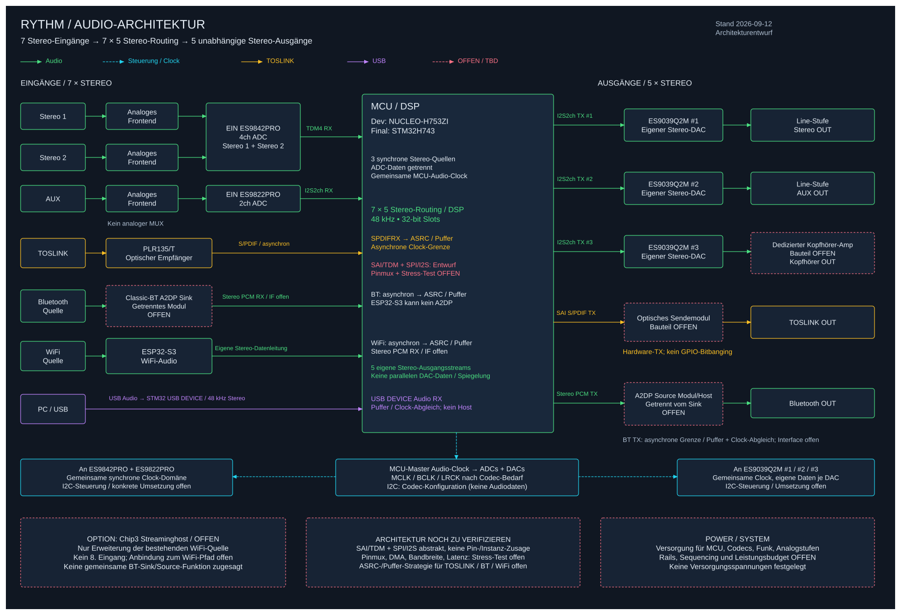

# RHYTHM – Hardware-Signalpfad & Clocking

> Stand: 2026-09-12 · Zielentwurf: **7 Stereo-Eingänge → 5 unabhängige Stereo-Ausgänge**.
> Dev: NUCLEO-H753ZI, final STM32H743. Pinmux, Registersetup, Clocks und Vollbetrieb noch nicht hardware-verifiziert.
> Oberliegend: [Architektur](../architecture.md) · [Kapazitätsprüfung](controller-capacity.md).

## 1. Blockschaltbild und Grundsätze



[Editierbare Quelle](block-diagram.excalidraw)

1. **Sechs analoge Kanäle gleichzeitig:** 1× ES9842PRO für Stereo 1/2 und 1× ES9822PRO für AUX. Kein analoger Quell-MUX, keine MUX-Steuer-GPIOs.
2. **Audio ≠ Steuerung:** PCM über SAI/TDM/I²S bzw. USB/SPDIFRX; Codec-Konfiguration über I²C/SPI, Frontend-Status gesondert über UART/SPI.
3. **Eine lokale Audio-Domäne, mehrere fremde Quellen:** 48-kHz-DSP-Takt für lokale ADC-/DAC-Verbindungen; externe TOSLINK-/BT-/Netzwerk-Takte müssen angepasst werden.
4. **Getrennte Daten für getrennte Mixe:** Geteilte BCLK/LRCLK sind möglich, parallele identische DAC-Datenleitungen liefern aber denselben Mix.
5. **USB ist ein eigener PC-Eingang:** MCU als Device, nicht Host. Der ST-Link-Anschluss ist kein USB-Audio-Port.
6. Der STM32 übernimmt Audio-Bus-Taktführung; die präzise physische Audio-Referenz (externer Oszillator/geeigneter PLL-Pfad) ist vor Hardwarefreigabe festzulegen. HSI-CPU-Takt ist kein Qualitätsnachweis für Audio-Clocks.

## 2. Vollständige Transportliste

Richtung aus Sicht des STM32. Logische Schnittstellen, noch keine verbindliche Pinmap.

| Pfad | Kanäle | Transport | Takt-/Pufferbehandlung |
|------|--------|-----------|-----------------------|
| Stereo 1 + Stereo 2, ES9842PRO | 4 RX | Eine TDM4-Datenleitung → SAI | Lokale Audio-Domäne, ADC Slave |
| AUX, ES9822PRO | 2 RX | Separate Stereo-I²S-Datenleitung → SAI/I²S | Lokale Audio-Domäne, ADC Slave |
| TOSLINK Eingang | 2 RX | Empfänger → SPDIFRX → DMA | Fremde Clock, ASRC/adaptives SRC erforderlich |
| Bluetooth Eingang | 2 RX | Classic-BT-Sink (offen) → eigene PCM-Leitung | Modul muss Taktführung/Rate-Matching unterstützen |
| WiFi Eingang | 2 RX | ESP32-S3 → eigene PCM-Leitung | Netzwerkpuffer, Dekodierung und Rate-Matching |
| USB Eingang | 2 RX | USB-Device, isochroner OUT-Endpunkt | Feedback/Puffer für lokale Audio-Clock |
| Stereo Ausgang | 2 TX | Eigene Stereo-PCM-Leitung → ES9039Q2M #1 | Lokal synchron |
| AUX Ausgang | 2 TX | Eigene Stereo-PCM-Leitung → ES9039Q2M #2 | Lokal synchron |
| Kopfhörer Ausgang | 2 TX | Eigene Stereo-PCM-Leitung → ES9039Q2M #3 | Lokal synchron, danach Kopfhörerverstärker |
| TOSLINK Ausgang | 2 TX | SAI S/PDIF-TX → optisches Sendemodul | Lokal 48 kHz, spezifischer SAI-Modus |
| Bluetooth Ausgang | 2 TX | Eigene PCM-Leitung → Classic-BT-Source (offen) | Modul-/Funkpuffer; getrennt vom BT-Eingang |

**Nicht mehr gültig:** ADCs/DACs/WiFi/BT pauschal auf nur drei Stereo-I²S-Verbindungen zusammenfassen. Ein SAI-Block transportiert mehrere Kanäle über TDM, aber nicht beliebige unabhängige Datenleitungen ohne passende Hardware.

## 3. ADC-Frontend und Slotplan

```text
Stereo 1 L/R → Schutz/Pegel/Filter/Differenztreiber → ES9842PRO CH1/2
Stereo 2 L/R → Schutz/Pegel/Filter/Differenztreiber → ES9842PRO CH3/4
                                                    │
                                      TDM4: Slots 0,1,2,3 → STM32 RX

AUX L/R      → Schutz/Pegel/Filter/Differenztreiber → ES9822PRO CH1/2
                                                    │
                                      I²S: L/R, 2×32 Bit → STM32 RX
```

- Slotzuordnung ES9842PRO: 0=Stereo1 L, 1=Stereo1 R, 2=Stereo2 L, 3=Stereo2 R.
- ES9822PRO: linker/rechter Slot = AUX L/R.
- 32-Bit-Slot und tatsächliche Datenbreite/Alignment explizit konfigurieren; Kanaltest mit unterschiedlichen Signalen vor DSP.
- TDM-Frame-Länge, Frame-Puls, Ein-Bit-Delay und Datenkante an beiden Enden konsistent setzen.
- Beide ADCs unterstützen I²S/TDM Master und Slave sowie TDM-Cascade. Für die Basis getrennte Datenleitungen verwenden; optionale TDM8-Kaskade erst nach Register-/Timingtest freigeben.
- Nicht die internen I²S-Decoder-/Delay-Funktionen der ADCs ungeprüft zum Zusammenführen verwenden: deren Wortbreiten können von der ADC-Ausgabe abweichen.
- I²C-Adressen per ADDR-Pins trennen oder SPI mit getrennten CS einsetzen; ESS-Adressbyte inklusive R/W-Bit von 7-Bit-Treiberadresse unterscheiden.
- Reset/CHIP_EN, MCLK-Verfügbarkeit und Registerreihenfolge gemäß Datenblatt. Normaler I²C-Zugriff kann bereits MCLK benötigen.
- Kein interner analoger PGA zugesichert; Eingangsempfindlichkeit durch Analogdesign bestimmen. Pegelbegrenzung vor Wandlung erforderlich, digitales Gain beseitigt kein Overload.

## 4. Lokales Clocking

### 4.1 Sample-, Bit- und Masterclock

Rechenbasis 48 kHz, 32-Bit-Slots:

| Verbindung | Bits pro Frame | BCLK |
|------------|----------------|------|
| Stereo-I²S | 2×32 = 64 | **3,072 MHz** |
| ES9842PRO TDM4 | 4×32 = 128 | **6,144 MHz** |
| Optionale ADC-TDM8-Kaskade | 8×32 = 256 | **12,288 MHz** |

TDM4 und Stereo-I²S können dieselbe Sample-/Referenzclock verwenden, aber nicht ohne Formatänderung dieselbe BCLK. SAI-A/B-Synchronisierung übernimmt ein gemeinsames Frameformat, nicht automatisch zwei verschiedene Slotzahlen. Entsprechend asynchron konfigurierte Subblöcke oder ein einheitliches TDM-Frameformat sind nötig.

**MCLK ist nicht automatisch BCLK oder 256×fs.** Das konkrete MCLK/fs-Verhältnis und die ADC-internen Divider nach den Tabellen „I²S Slave Clock Rate Configurations“ bzw. „TDM Slave Clock Rate Configurations“ der beiden ESS-Datenblätter wählen. Ein beliebiger alter 12,288-MHz-MCLK-Eintrag ist keine Freigabe. DAC und STM32-Kernelclock ebenso darauf abstimmen; Jitter, Fanout, Leitungslängen und Resetreihenfolge prüfen.

### 4.2 Fremde Takte

- **TOSLINK:** Clock Recovery durch SPDIFRX, danach elastischer Puffer und ASRC/adaptives SRC auf lokale 48 kHz. Ein FIFO allein verhindert keinen dauerhaften Drift.
- **BT RX / WiFi:** Dekodierte Samplerate kann z. B. 44,1 kHz sein; Frontend/Host resampelt und gleicht den tatsächlichen Verbrauch der lokalen PCM-Clock aus. Slave-I²S allein ist kein SRC.
- **USB:** Isochrone Transfers orientieren sich am Host-SOF. Asynchrones Playback mit Feedback an den Host ist der Entwurf; das Feedback muss den tatsächlichen Audioverbrauch abbilden.
- **BT TX:** Lokale PCM-Ausgabe und Funkübertragung sind getrennte Zeitabläufe; Modulpuffer und Codec-Latenz berücksichtigen. Keine samplegenaue Gleichzeitigkeit mit Line/TOSLINK versprechen.

### 4.3 CPU- und USB-Clocks

CPU-Clock, Audio-Kernelclock und USB-48-MHz-Takt separat konfigurieren. USB benötigt eine spezifikationsgerechte Taktquelle; die Audio-PLL ist nicht automatisch USB-tauglich. Beim aktuellen H753-Clock-Entwurf bestehen Rechen-/Busgrenzenprobleme: siehe [Controller-Kapazität](controller-capacity.md) und Warnhinweis in [Clock-Verifikation](../../firmware/docs/clock-verification.md). Keine Board-Neukonfiguration Teil dieser Dokumentationsänderung.

## 5. TOSLINK RX/TX

### Eingang

Optischer Empfänger (PLR135/T bisheriger Kandidat) → elektrisches S/PDIF-Signal → **SPDIFRX-Eingangsfunktion** des STM32 → DMA/Statusauswertung → SRC → DSP.

- Empfängerlogik/VCC und maximale optische Sample-Rate prüfen.
- Lockverlust, Parität, Channel Status und gültige PCM-Daten behandeln.
- Unterstützte Eingangs-Sampleraten erst nach SRC-/Locktests zusagen.
- Kein pro-Flanke-GPIO-Interruptdecoder. **AN5073 beschreibt die STM32-S/PDIF-Schnittstellen**, nicht einen automatisch resampelnden Softwaredecoder.

### Ausgang

DSP-Stereomix → DMA → **SAI im S/PDIF-TX-Modus** → passendes optisches Sendemodul → TOSLINK.

- SAI-Subblock/-Pin, Kanalstatus, Nutzdatenformat und Clock-Divider nach RM0433/AN5073 konfigurieren.
- 32-Bit interne Speicherwörter bedeuten nicht 32 Bit PCM-Nutzdaten im S/PDIF-Format; Formatkonvertierung/Dither bei Reduktion festlegen.
- S/PDIF-Biphase-Signal ist nicht die Stereo-I²S-BCLK. Keine alte pauschale „32×fs“-Verdrahtung übernehmen.
- Konkretes optisches Sendemodul, Versorgung und Ansteuerung offen. Keine unbestätigte IR-LED-/Widerstandsschaltung.

## 6. USB-Audio-Eingang

- PC (Host) → eigener MCU-USB-Anschluss → USB-Audio-Device → Stereo-Puffer → Mixer.
- Initial 48 kHz, zwei Kanäle. UAC-Version und USB-PCM-Bittiefe offen; 16/24/32-Bit-Formate benötigen passende Deskriptoren und Konvertierung.
- Bei 32-Bit-Containern: 384 Byte pro nomineller Millisekunde; ein Stereo-Stream passt grundsätzlich in USB Full Speed. Maximale Paketgröße mit Feedback-/Takttoleranz dimensionieren, nicht nur exakt den Mittelwert reservieren.
- Asynchrones Playback mit Feedback-Endpunkt als Basis; Enumeration, Windows/Linux-Host, Start/Stop, Suspend/Resume und Kabelabzug prüfen.
- D+/D−, VBUS-Erkennung, ESD und Strompfad auf tatsächlichem Board/Package prüfen; kein Rückspeisen zwischen PC und externer Versorgung.
- ST-Link-USB bleibt Debug; kein USB-Host oder Speicherplayer vorgesehen.

## 7. DACs und analoge Ausgänge

Drei separat geroutete Stereo-PCM-Leitungen zu drei ES9039Q2M-Pfaden:

1. Stereo-DAC → Tiefpass/Puffer/Line-Treiber → Stereo-Ausgang.
2. AUX-DAC → Tiefpass/Puffer/Line-Treiber → AUX-Ausgang.
3. Kopfhörer-DAC → geeigneter Kopfhörerverstärker → Klinke.

Geteilte Takte, getrennte Audiodaten. ADC-/DAC-I²C-Adressen zusammen prüfen; SPI-CS oder zusätzlicher Steuerbus bleibt Option. Analoge Ausgangspegel, Lasten, Strombegrenzung, Einschaltmute und Pop-Unterdrückung sind offen. Kein Kopfhörer direkt am DAC und keine unabhängige Ausgabe durch bloßen Parallelabgriff.

## 8. Versorgung, Masse und PCB

- Bisheriges 5-V-Netzteilkonzept ist ein Ausgangspunkt, **keine nachgewiesene Leistungsreserve** für die neue Vollausstattung.
- ADCs: Pinlisten nennen 4,5-V-Analog- und 3,3-V-I/O-Versorgung; Referenzen und interne Core-Regler nach Datenblatt beschalten. Nicht alle Pins pauschal mit 3,3 V speisen.
- DAC-, MCU-, Frontend- und Kopfhörer-Rails getrennt aus den jeweiligen Anforderungen ableiten; eventuell zusätzliche/negative Analogversorgung nötig.
- Ruhige Analog-/Referenzversorgung, Decoupling nahe den Pins, kurze Rückstromwege und durchgängige sinnvolle Massefläche. Keine pauschal aufgetrennten Masseflächen unter schnellen Signalen.
- Clock-Fanout und Flanken kontrollieren; vierlagige Platine als Zielansatz. Layout und thermische/elektrische Dimensionierung bleiben offen.
- ADCs/DACs auf passenden Modulen/Platinen prototypisieren; QFN-Chips und hochohmige Analogreferenzen nicht über lange Steckbrettleitungen verdrahten.
- MUX-Versorgung, MUX-Testpunkte und MUX-Auswahlleitungen entfallen. Neue Testpunkte für beide ADC-Datenströme, drei DAC-Ströme, USB, SPDIFRX/TX und unabhängige BT-/WiFi-Pfade.
- Bestehende KiCad-Projekte bleiben unverändert; Schaltplan-/Layoutmigration und elektrische Prüfung sind separate Aufgaben.

## 9. Stufenweise Verifikation

| Stufe | Aufbau / Test | Abnahmekriterium |
|-------|---------------|-----------------|
| 1 | H753-CPU-/Busclock und Zeitbasis | Register und externe Zeitmessung, kein falsches 400-MHz-Label |
| 2 | Audio-Referenz, ein DAC | Logikanalysator: Rate, Slots, Clock-Verhältnis; Testsignal |
| 3 | ES9842PRO + ES9822PRO | Sechs verschiedene analoge Kanal-Testsignale gleichzeitig, kein MUX |
| 4 | USB und TOSLINK RX | USB-Feedback und ASRC, kein langfristiger FIFO-Drift |
| 5 | WiFi, BT RX und BT TX | Unabhängige Streams, Funk-/Codec-Rollen und Taktführung verifiziert |
| 6 | Drei DACs + TOSLINK TX + BT TX | Fünf separat geroutete Stereo-Ausgänge |
| 7 | Gesamtsystem mit EQ/Mixer/UI | Blockdeadline, DMA/Cache, Last, Latenz und Dropout-Zähler |
| 8 | PCB-/Analogvalidierung | Pegel, THD+N, Rauschen, Versorgung, thermische Reserve und Schutz |

Die Teststufen sind **noch auszuführen**, nicht bereits bestanden. Rechenwerte und vorläufiges Ressourcenbudget im [Controller-Check](controller-capacity.md).
